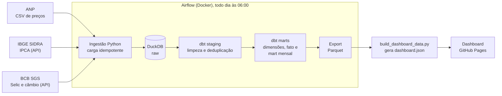

# Observatório de Preços e Inflação (Brasil)

> **Status: pipeline, orquestração e dashboard concluídos.**

Pipeline ELT com dados públicos para analisar como o preço dos combustíveis ao
consumidor se relaciona com inflação (IPCA), Selic e câmbio.

**Fontes:** ANP (preços de revenda), IBGE SIDRA (IPCA) e Banco Central SGS (Selic e câmbio).
**Stack:** Python, DuckDB, dbt, Airflow, Docker, GitHub Pages.

## Dashboard

**[Abrir o dashboard](https://cardosoarthur.github.io/observatorio-precos/)** (página estática no GitHub Pages; dados até 09/2026, último mês completo com IPCA publicado).

### Números do projeto

| Métrica | Valor |
| --- | --- |
| Modelos dbt | 9 (3 staging, 5 dimensões/fato e 1 mart mensal) |
| Testes dbt | 61 (56 de dados e 5 unitários) |
| Testes em Python | 20 (pytest) |
| Linhas no mart mensal | 8.833 |

### Insights

Todos os números abaixo saem do mart `mart_preco_inflacao_mensal` (script `scripts/build_dashboard_data.py`). O preço nacional é a média ponderada pelo número de observações, e células UF/produto/mês com menos de 30 observações ficam fora das comparações entre UFs.

1. **Gasolina ficou 21,0% mais barata em termos reais.** Entre jan/2022 e set/2026 o preço nacional foi de R$ 6,64 para R$ 6,56 (-1,2% nominal), enquanto o IPCA acumulou +25,1%.
2. **Combustíveis se moveram de forma muito diferente (jan/2022 a set/2026).** Diesel S10 +28,8%, diesel +23,2%, GNV +6,9%, gasolina aditivada -0,4%, gasolina -1,2% e etanol -17,9%.
3. **O etanol compensa em 11 de 26 UFs** (razão etanol/gasolina abaixo de 70% em set/2026). As menores razões são MT (58,6%), SP (59,8%) e MS (60,9%); as maiores, RN (78,1%), MA (76,8%) e SE (76,5%). Os 70% são uma regra prática, não um limite exato.
4. **Gasolina em RR custa 20,2% mais que no RS** em set/2026 (R$ 7,57 contra R$ 6,30).
5. **Diesel S10 e dólar não mostram relação linear mensal.** A correlação das variações mensais é 0,03 (57 meses). Correlação baixa não prova ausência de causalidade: há defasagens, tributos e política de preços.

## Arquitetura



Camadas: `raw` (tudo texto, com metadados de carga) -> `staging` (tipagem e regras de qualidade) -> `marts` (modelo estrela e mart mensal). As decisões e seus motivos estão em [`docs/decisions.md`](docs/decisions.md).

## O que já existe

| Etapa | Entrega | Status |
| --- | --- | --- |
| S3 | Loaders da ANP, SIDRA e SGS para DuckDB (camada `raw`), com testes | Pronto |
| S4 | dbt: camada `staging` (tipagem, limpeza, deduplicação) com testes | Pronto |
| S4 | dbt: dimensões, fato e mart mensal (preço x IPCA x Selic x câmbio) | Pronto |
| S5 | Testes de qualidade (dados e unitários), staging incremental, freshness e docs | Pronto |
| S6 | Orquestração: DAG do Airflow em Docker (ingestão, dbt, export Parquet) | Pronto |
| S7 | Diagrama de arquitetura e dashboard publicado no GitHub Pages | Pronto |

## Como rodar a ingestão da ANP

Requer Python 3.10 ou superior. Os CSVs da ANP não ficam no Git: baixe-os da
[página de dados abertos da ANP](https://www.gov.br/anp/pt-br/centrais-de-conteudo/dados-abertos/serie-historica-de-precos-de-combustiveis)
e organize assim:

```
data/raw/anp/
├── semestral/           # CSVs semestrais (descompactados dos ZIPs)
├── mensal/              # CSVs mensais
└── ultimas_4_semanas/   # CSVs das quatro últimas semanas
```

Em seguida (PowerShell):

```powershell
python -m venv .venv
.\.venv\Scripts\Activate.ps1
pip install -r requirements-dev.txt
python -m pytest
python -m ingestion anp
```

Para as APIs: `python -m ingestion sgs`, `python -m ingestion sidra` ou
`python -m ingestion all` (ANP + SGS + SIDRA, em sequência: o DuckDB aceita um
escritor por vez).

O banco é criado em `warehouse/observatorio.duckdb` (ignorado pelo Git). Rodar o
comando de novo não duplica dados: arquivos inalterados são pulados, e `--force`
recarrega todos.

## Como rodar o dbt

Na raiz do repositório, com a venv ativa e o `raw` já carregado:

```powershell
dbt build --project-dir dbt --profiles-dir dbt
```

Cria os schemas `staging` e `marts` (dimensões, fato e mart mensal) e roda os testes
(de dados e unitários). Comandos úteis:

```powershell
dbt build --full-refresh --project-dir dbt --profiles-dir dbt   # reconstrói tudo (use após mudar a lógica do staging)
dbt source freshness --project-dir dbt --profiles-dir dbt       # confere se as fontes estão atualizadas
dbt docs generate --project-dir dbt --profiles-dir dbt          # gera a documentação
dbt docs serve --project-dir dbt --profiles-dir dbt             # abre o catálogo e o grafo de linhagem
```

O `stg_anp_precos` é incremental: depois de carregar um arquivo novo no `raw`, o dbt
recalcula só as chaves afetadas. Se um arquivo for **removido** do `raw`, use `--full-refresh`. O caminho do banco
vem de `DUCKDB_PATH` (padrão `warehouse/observatorio.duckdb`).

## Como rodar com Airflow (Docker)

Requer Docker Desktop. Na raiz do repositório:

```powershell
docker compose build
docker compose up airflow-init
docker compose up -d
```

Abra http://localhost:8080 (ambiente local de desenvolvimento, sem senha). A DAG
`observatorio_pipeline` roda todo dia às 06:00 (America/Sao_Paulo):

```
ingest_sgs -> ingest_sidra -> ingest_anp -> dbt_build -> export_marts -> dbt_freshness
```

As tarefas rodam em sequência porque o DuckDB aceita um escritor por vez. Para disparar
agora: `docker compose exec airflow-scheduler airflow dags trigger observatorio_pipeline`.

- O warehouse fica num volume Docker (`warehouse`), separado do `warehouse/` local.
- Os Parquet para dashboard saem em `exports/` (ignorado pelo Git).
- Os CSVs da ANP são lidos de `data/raw/anp` (somente leitura).
- Para desligar: `docker compose down` (use `-v` para apagar também o warehouse e o histórico).

## Como atualizar o dashboard

Depois de rodar o pipeline (ou a DAG), com a venv ativa:

```powershell
python -m ingestion export
python scripts/build_dashboard_data.py
cd docs
python -m http.server 8000   # pré-visualização em http://localhost:8000
```

O `docs/data/dashboard.json` é versionado: fazer commit dele e dar push atualiza o site (GitHub Pages, branch `main`, pasta `/docs`).

## Estrutura

```
ingestion/    # loaders Python (anp, sgs, sidra, export, cli) e testes
airflow/      # DAG, Dockerfile e dependências do pipeline (docker-compose.yaml na raiz)
dbt/          # projeto dbt: models/staging, tests, macros, profiles.yml
scripts/      # probe_sources.py, check_raw.py e build_dashboard_data.py (gera o JSON do dashboard)
docs/         # decisions.md (decisões técnicas) e o dashboard estático (index.html, data/dashboard.json)
data/         # dados brutos (fora do Git)
warehouse/    # arquivo DuckDB (fora do Git)
```

## Limitações conhecidas

- Os preços da ANP vêm de uma pesquisa semanal por **amostra** de postos, não de um censo.
- A frequência de atualização depende de cada fonte.
- O preço nacional é uma média ponderada pelo número de observações, não uma média oficial.
- O preço real usa o IPCA geral como deflator, não um índice específico de combustíveis.
- Não há integração contínua (CI) automatizada: os testes rodam localmente (`pytest` e `dbt build`) e dentro da DAG.
